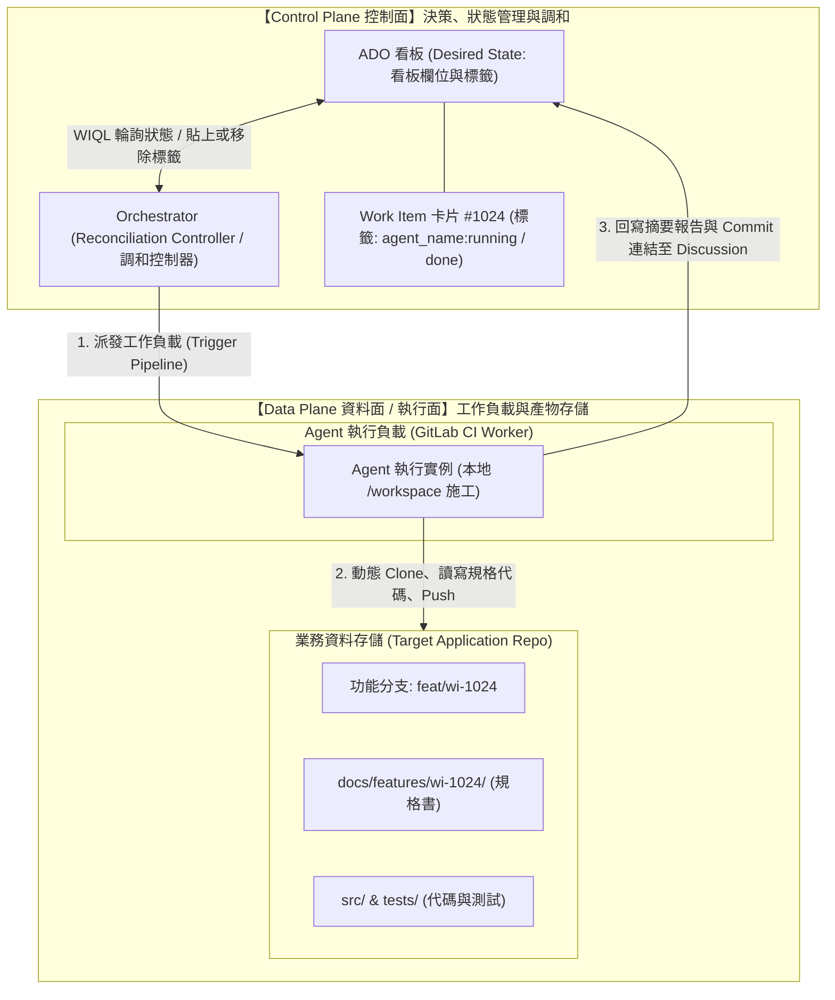
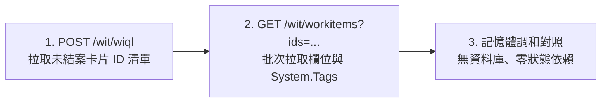
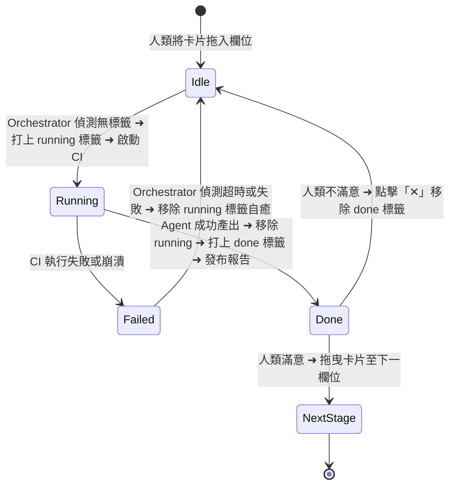
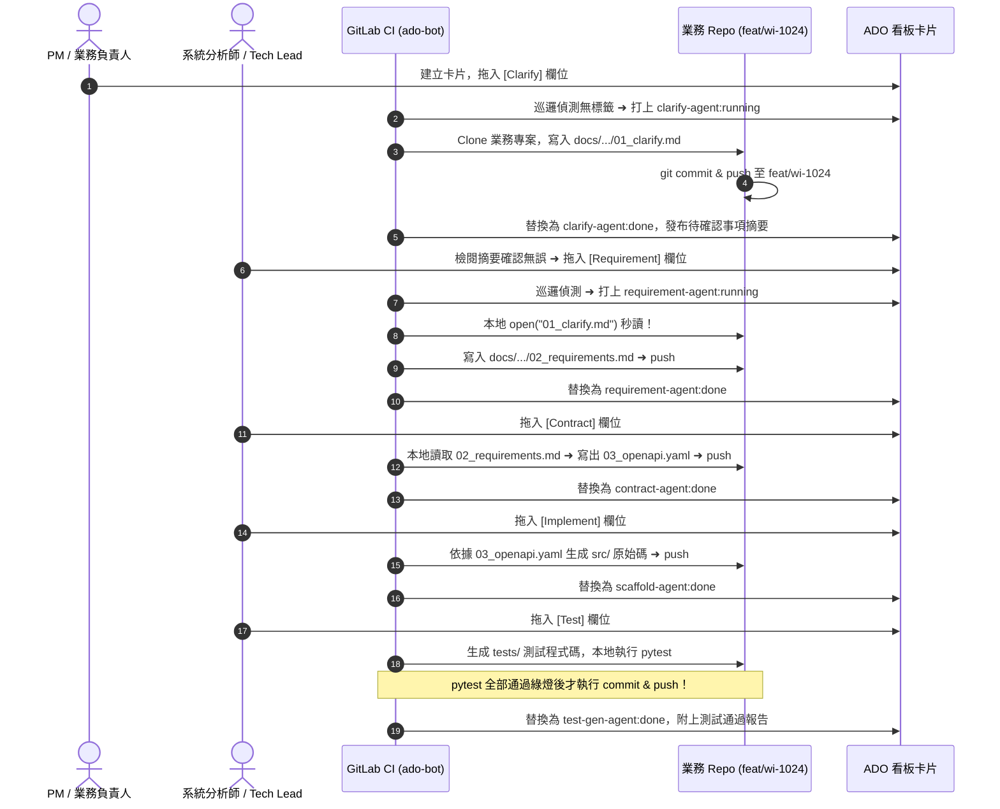
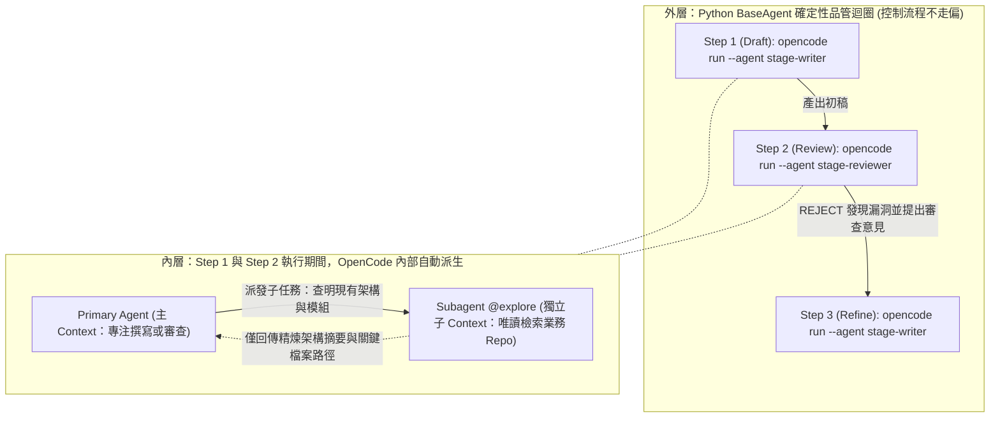

# Azure DevOps AI Bot 框架 — 企業級落地設計規格書

> **文件版本：** v3.0 (生產落地與架構審查決策版)  
> **發布日期：** 2026-10-24  
> **適用對象：** 架構師 (Architect)、DevOps 工程師、產品/專案經理 (PM/PO)、資安稽核團隊  
> **核心目標：** 為部門建立一套以 **Azure DevOps (ADO)** 為看板入口、**GitLab CI** 為調度引擎、**Docs-as-Code** 為上下文核心的通用 SDLC AI 自動化機器人架構。

---

## 1. 執行摘要 (Executive Summary)

### 1.1 核心痛點與架構解法

| 既有痛點 / 企業限制 | 傳統方案的致命缺陷 | 本框架的架構解法 (經得起考驗) |
|---|---|---|
| **公司無法使用 ADO Webhook** | 使用 ETL Reporting API + ContinuationToken，導致卡片漏跑永久餓死 (Starvation) | **WIQL 純狀態調和**：每 5 分鐘拉取看板即時活狀態快照，無狀態、零記憶體負擔、100% 具備自癒性 (Self-healing)。 |
| **人類不願意手動打標籤或打英文指令** | 強迫人類打審批標籤 (`ai-bot:approved`)，遭人類排斥而形同虛設 | **方案 A 極簡協同**：推進靠拖曳；產物不合格時**在卡片上直接按「✕」點掉 `{agent_name}:done` 標籤**，機器人秒懂原地重跑。 |
| **禁止為了 AI 重構或翻倍看板欄位** | 將欄位拆成 Doing / Done（8 欄瞬間變 16 欄），看板橫向捲動爆炸 | **100% 相容現有看板**：完全不更動公司既有欄位，透過後台微標籤完成狀態閉環。 |
| **上下文傳遞繁瑣、附件碎片化** | 把 ADO 當檔案系統（Attachment API），遇速率限制、無 Git Diff、跨階段難以串接 | **Docs-as-Code (Repo-Centric)**：所有規格與代碼納入 Git Repo，GitLab CI 原生 `git clone` 本地秒讀（< 1ms），速度提速 100 倍。 |
| **工具腳本與業務專案混雜** | 全公司各微服務的代碼與規格全混在 Bot 倉庫 | **雙儲存庫解耦**：Bot 倉庫 (`ado-bot`) 僅作為純淨通用工具箱；Agent 動態拉取各業務專案到拋棄式容器施工。 |

### 1.2 預期效益量化指標

- **零延遲上下文存取**：文件存取從 REST API 下載（1~5 秒）降為本地磁碟 I/O（< 1 毫秒），**效能提升 100 倍以上**。
- **維護成本極小化**：全公司數十個微服務專案共用同一套 `ado-bot` 引擎，新增 Agent 零改動業務代碼。
- **人機摩擦力降至零**：人類無需學習任何新系統，完全在 ADO 原生看板拖拉即可驅動全自動 AI 流水線。

---

## 2. 系統架構與雙平面劃分 (Two-Plane Architecture)

本系統嚴格遵循 Kubernetes 與分散式系統經典的**雙平面架構（Control Plane 與 Data Plane）**，邊界清晰，完全符合業界權威規範：



### 2.1 雙平面職責分工表

| 系統架構平面 | 組成元件 | 經典系統對照 (如 K8s) | 核心職責 | 存放內容 |
|---|---|---|---|---|
| **Control Plane<br/>(控制面)** | **Azure DevOps**<br/>+ **Orchestrator** | API Server +<br/>Controller Manager | **宣告式狀態管理與調和**<br/>- ADO 提供期望狀態 (Desired State)<br/>- Orchestrator 負責調和迴圈 (Reconcile Loop) | 看板欄位進度、卡片標籤 (`agent_name:done`)、Discussion 決策摘要 |
| **Data Plane<br/>(資料面 / 執行面)** | **GitLab CI Worker**<br/>+ **目標業務 Git Repo** | Kubelet / Pod +<br/>Persistent Storage | **業務負載執行與產物存儲**<br/>- Agent 執行 LLM 推理、寫代碼、跑單元測試<br/>- 目標 Repo 作為單一真實來源留痕 | 拋棄式容器工作區 (`/workspace`)、規格文件 (`docs/`)、原始碼 (`src/`)、測試 (`tests/`) |

---

## 3. 狀態獲取與調和引擎 (WIQL Pure Reconciliation)

> [!IMPORTANT]
> **架構決策防線：為什麼堅決否定 ETL Reporting Revisions API？**  
> ADO 的 Reporting Revisions API 是為資料倉儲批次匯入設計的，依賴單向推進的 `continuationToken`。一旦某次 CI 執行因網路抖動中斷，該 Token 推進後，漏跑的卡片將**永遠失去被處理的機會（永久餓死 Starvation）**。  
> 因此，本架構採用 **WIQL 純狀態調和 (State Reconciliation)**，每次輪詢皆為無狀態快照，具備 100% 自癒性。

### 3.1 兩段式快照查詢機制

Orchestrator 醒來時，僅需發出兩道極輕量的 REST API 請求：



#### 步驟 1：WIQL 查詢活躍工作項目
```sql
SELECT [System.Id]
FROM WorkItems
WHERE [System.TeamProject] = @project
  AND [System.State] NOT IN ('Closed', 'Done', 'Removed')
ORDER BY [System.ChangedDate] DESC
```

#### 步驟 2：批次抓取卡片欄位與 Tags
- 呼叫：`GET /wit/workitems?ids=101,102,...&fields=System.Id,System.BoardColumn,System.Tags,System.AreaPath`
- 以 100 筆為一個 Chunk 分頁批次查詢，耗時約 200~400ms，對 ADO 伺服器負載極低。

### 3.2 派工判定演算法（樂觀鎖與失敗回滾）

```python
# 欄位與 Agent 映射表（KISS 原則：一個欄位一個核心負責 Agent）
STAGE_MAPPING = {
    "Clarify": "clarify-agent",
    "Requirement": "requirement-agent",
    "Contract": "contract-agent",
    "Implement": "scaffold-agent",
    "Test": "test-gen-agent",
}

for card in cards:
    column = card["column"]
    if column not in STAGE_MAPPING:
        continue

    agent_name = STAGE_MAPPING[column]
    done_tag = f"{agent_name}:done"
    running_tag = f"{agent_name}:running"

    # 核心調和：只要該 Agent「沒做過」且「沒有人在執行中」，立即派工！
    if done_tag not in card["tags"] and running_tag not in card["tags"]:
        # 1. 先打上 running 標籤（樂觀鎖，防止同一輪或下輪重複觸發）
        ado.add_tag(card["id"], running_tag)

        # 2. 觸發 GitLab CI Pipeline
        success = trigger_gitlab_agent(agent_name, card["id"])

        # 3. 失敗回滾防護：若啟動失敗，立即移除 running，避免卡片死鎖
        if not success:
            ado.remove_tag(card["id"], running_tag)
```

---

## 4. 人機協同規範（方案 A：人類零認知負擔）

### 4.1 核心操作矩陣

| 人類意圖 | 人類操作行為 | 系統偵測與反應 |
|---|---|---|
| **滿意推進 (Forward)** | 在 ADO 看板上，直接將卡片**往右拖曳到下一欄位** | Orchestrator 下次輪詢偵測到新欄位，發現無下一階段的 `{agent_name}:done`，自動啟動新階段 Agent 接力。 |
| **原地修改 (Re-run in place)** | 1. 在 Discussion 留下修改意見（可選）<br/>2. **直接在卡片上點擊標籤旁的「✕」刪除 `{agent_name}:done`** | Orchestrator 偵測到標籤消失，秒懂產物不合格，**立即在原欄位重跑該 Agent**。 |
| **退回重審 (Rollback)** | 將卡片**往左拖回上一欄位** | 依據前一欄位標籤狀態，決定是否重審或重跑前置 Agent。 |

### 4.2 狀態標籤生命週期全景圖



---

## 5. 上下文管理規範：Docs-as-Code (Repo-Centric)

### 5.1 為什麼淘汰 ADO Attachment？

1. **不可變性與可稽核性**：ADO Attachment 沒有真正的版本差異（Git Diff），檔案覆蓋時無法查看具體修改了哪些行；Git Repo 每一筆變更皆有 Commit Hash、作者與逐行差異。
2. **閉環驗證能力**：若將規格存在卡片附件，代碼生成 Agent 與測試生成 Agent 無法在同一個環境中進行交叉驗證；Docs-as-Code 讓 Agent 可以在本地磁碟中**一邊參考 OpenAPI 合約、一邊寫代碼、一邊跑 `pytest`**。

### 5.2 目標業務儲存庫標準目錄規範

所有由 Bot 處理的業務專案，均採用統一且隔離的檔案目錄佈局：

```text
<target-application-repo>/
├── docs/
│   └── features/
│       └── wi-1024/                     <-- 每個 Work Item 擁有獨立資料夾 (wi-{ID})
│           ├── 01_clarify.md            <-- [Clarify Agent] 需求分析與確認事項
│           ├── 02_requirements.md       <-- [Requirement Agent] SA 系統分析規格書
│           └── 03_openapi.yaml          <-- [Contract Agent] API 介面規格契約
├── src/                                 <-- [Scaffold Agent] 後端業務邏輯實作代碼
└── tests/                               <-- [Test Gen Agent] 單元與整合測試代碼 (含 pytest)
```

### 5.3 跨 Agent 接力鏈條 (Relay Lifecycle)



---

## 6. 通訊介面與 API 規格書 (API & SDK Specification)

> [!NOTE]
> **架構設計決策：為什麼不將 Agent 做成常駐的 HTTP Server 微服務？**  
> AI Agent 任務（涵蓋 `git clone`、LLM 多輪推理、撰寫代碼與執行 `pytest`）平均耗時 **2 ~ 10 分鐘**。若採用傳統常駐 HTTP API Server，必然面臨 Gateway Timeout (60s)、多請求同時湧入導致 `/workspace` 磁碟覆寫互撞、以及 24 小時空轉浪費 K8s 算力等問題。  
> 因此，本框架直接以 **GitLab Pipeline API 作為 Serverless Job API 閘道**，每次呼叫自動啟動 100% 獨立隔離的拋棄式容器，跑完即毀，並透過共用 `BaseAgent` SDK 讓全團隊在同一儲存庫內無痛協作。

---

### 6.1 調度觸發介面：GitLab Pipeline Trigger API (Control Plane ➜ Data Plane)

Orchestrator 判定需要派工時，呼叫 GitLab 原生 REST API 啟動單一 Agent 容器工作負載。

- **HTTP Method**: `POST`
- **Endpoint**: `{GITLAB_URL}/api/v4/projects/{GITLAB_PROJECT_ID}/pipeline`
- **Request Headers**:
  | Header 名稱 | 必填 | 值 / 格式 | 說明 |
  |---|---|---|---|
  | `PRIVATE-TOKEN` | 是 | `<GITLAB_TOKEN>` | 具備 `api` 或專案 Maintainer/Developer 權限之存取權杖 |
  | `Content-Type` | 是 | `application/json` | JSON 格式內容類型 |

- **Request Body Schema**:
  | 欄位路徑 | 型別 | 必填 | 說明 |
  |---|---|---|---|
  | `ref` | `string` | 是 | `ado-bot` 工具儲存庫分支名稱（預設 `"main"`） |
  | `variables` | `array<object>` | 是 | 注入至 CI 容器環境變數的 Key-Value 陣列 |
  | `variables[].key` | `string` | 是 | 變數名稱（見下方契約表） |
  | `variables[].value` | `string` | 是 | 變數內容（一律轉為字串） |

- **動態注入變數契約表（最小必要原則，不傳遞卡片龐大內文）**：
  | 變數 Key | 必填 | 範例值 | 用途與行為定義 |
  |---|---|---|---|
  | `WORK_ITEM_ID` | 是 | `"1024"` | 唯一目標卡片 ID。Agent 啟動後自行向 ADO 拉取即時內容。 |
  | `AGENT_NAME` | 是 | `"clarify-agent"` | 決定路由並啟動對應腳本 `agents/clarify_agent.py`，以及打上 `clarify-agent:done` 標籤。 |
  | `TARGET_BRANCH` | 是 | `"feat/wi-1024"` | 目標業務專案的施工分支。 |
  | `TARGET_REPO_URL` | 條件必填 | `"https://gitlab.example.com/backend/order-service.git"` | 目標業務專案 Git 網址（供 Agent 動態 clone 至 `/workspace`）。 |
  | `ADO_ORGANIZATION` | 是 | `"my-org"` | ADO 組織名稱。 |
  | `ADO_PROJECT` | 是 | `"my-project"` | ADO 專案名稱。 |

- **Request Payload 範例**:
  ```json
  {
    "ref": "main",
    "variables": [
      { "key": "ADO_ORGANIZATION", "value": "my-org" },
      { "key": "ADO_PROJECT", "value": "my-project" },
      { "key": "WORK_ITEM_ID", "value": "1024" },
      { "key": "AGENT_NAME", "value": "clarify-agent" },
      { "key": "TARGET_BRANCH", "value": "feat/wi-1024" },
      { "key": "TARGET_REPO_URL", "value": "https://gitlab.example.com/backend/order-service.git" }
    ]
  }
  ```

- **Response Payload 範例 (`HTTP 201 Created`)**:
  ```json
  {
    "id": 98452,
    "iid": 412,
    "project_id": 15,
    "status": "created",
    "source": "api",
    "ref": "main",
    "sha": "7b8d9a1c3f4e5d6a7b8c9d0e1f2a3b4c5d6e7f8a",
    "web_url": "https://gitlab.example.com/devops/ado-bot/-/pipelines/98452",
    "created_at": "2026-10-24T14:00:01.123Z"
  }
  ```

- **狀態碼與錯誤處置規範**:
  | HTTP Status | 意義 | Orchestrator 處置行為 |
  |---|---|---|
  | `201 Created` | Pipeline 成功建立並進入佇列 | 記錄 Pipeline ID，保留卡片上的 `{agent_name}:running` 標籤。 |
  | `400 / 401 / 403 / 404` | 參數錯誤、Token 過期或無權限 | 記錄 Error Log，**立即呼叫 ADO API 回滾移除 `{agent_name}:running` 標籤**。 |
  | `5xx / Timeout` | GitLab 服務異常或網路超時 | **立即回滾移除 `{agent_name}:running` 標籤**，待下一輪巡邏自動重試。 |

#### 搭配 `.gitlab-ci.yml` 的單一通用路由機制

所有團隊開發的 Agent 皆存放在 `ado-bot/agents/` 下。透過 `$AGENT_NAME` 變數與 `rules: if` 過濾，每次 API 觸發時，GitLab **只會執行 `run-agent` 這一個 Stage/Job**，並自動將 `clarify-agent` 映射為 `clarify_agent.py` 執行，新增 Agent **完全無需修改 `.gitlab-ci.yml`**：

```yaml
stages:
  - orchestrate
  - agent-run

# 1. 排程巡邏（僅在 Schedule 時啟動）
orchestrator-poll:
  stage: orchestrate
  rules:
    - if: '$CI_PIPELINE_SOURCE == "schedule"'
  script:
    - python orchestrator/prototype.py

# 2. 通用 Agent 動態路由執行器（僅在傳入 AGENT_NAME 時啟動）
run-agent:
  stage: agent-run
  rules:
    - if: '$AGENT_NAME'
  script:
    - SCRIPT_NAME=$(echo "$AGENT_NAME" | tr '-' '_').py
    - cd agents && python "$SCRIPT_NAME"
```

---

### 6.2 團隊多人協作與品管規範：OpenCode 配置驅動架構 (`opencode.json` + 三明治審查迴圈)

為了避免單一 Agent「邊翻找數十個舊檔案污染 Context，又球員兼裁判自己審查自己」，本框架採用 **「外層 Python 確定性迴圈 (`UniversalOpenCodeAgent`) + 內層 OpenCode 子代理 (`@explore`)」** 的配置驅動（Configuration-Driven）設計。

各部門擴充或調整任何 SDLC 階段時，**無需撰寫任何 Python 程式碼**，只需在 [`opencode.json`](../opencode.json) 與 [`prompts/`](../prompts/) 目錄下維護 Markdown 提示詞與目錄讀寫權限邊界。



#### 1. 全 SDLC 階段權限邊界與角色矩陣 (`opencode.json`)

透過 [`opencode.json`](../opencode.json) 的 `permission` 宣告式鎖定，從底層杜絕「寫測試的 Agent 偷改業務代碼來讓測試通過」或「審查員動手改壞檔案」的風險：

| 階段 (`AGENT_NAME`) | Primary Writer 角色 | Primary Reviewer 角色 (唯讀) | 允許寫入路徑 (`edit` / `write`) | 允許執行指令 (`bash`) |
|---|---|---|---|---|
| `clarify-agent` | `clarify-agent-writer`<br/>([`01-clarify-writer.md`](../prompts/01-clarify-writer.md)) | `clarify-agent-reviewer`<br/>([`01-clarify-reviewer.md`](../prompts/01-clarify-reviewer.md)) | 僅限 `docs/features/**`<br/>(`01_clarify.md`) | 僅限 `git status/diff/log` |
| `requirement-agent` | `requirement-agent-writer`<br/>([`02-requirement-writer.md`](../prompts/02-requirement-writer.md)) | `requirement-agent-reviewer`<br/>([`02-requirement-reviewer.md`](../prompts/02-requirement-reviewer.md)) | 僅限 `docs/features/**`<br/>(`02_requirements.md`) | 僅限 `git status/diff/log` |
| `contract-agent` | `contract-agent-writer`<br/>([`03-contract-writer.md`](../prompts/03-contract-writer.md)) | `contract-agent-reviewer`<br/>([`03-contract-reviewer.md`](../prompts/03-contract-reviewer.md)) | 僅限 `docs/features/**`<br/>(`03_openapi.yaml`) | OpenAPI Linter (`redocly` / `openapi-generator-cli`) |
| `scaffold-agent` | `scaffold-agent-writer`<br/>([`04-scaffold-writer.md`](../prompts/04-scaffold-writer.md)) | `scaffold-agent-reviewer`<br/>([`04-scaffold-reviewer.md`](../prompts/04-scaffold-reviewer.md)) | 僅限 `src/**`, `app/**`, `internal/**`<br/>(**禁止竄改 `docs/features/**`**) | 編譯與靜態檢查 (`py_compile`, `ruff`, `npm run build`, `go build`) |
| `test-gen-agent` | `test-gen-agent-writer`<br/>([`05-test-writer.md`](../prompts/05-test-writer.md)) | `test-gen-agent-reviewer`<br/>([`05-test-reviewer.md`](../prompts/05-test-reviewer.md)) | 僅限 `tests/**`, `test/**`<br/>(**禁止竄改 `src/**` 業務代碼**) | 測試執行器 (`pytest`, `npm test`, `go test`) |

#### 2. 跨目錄設定檔掛載與自動變更偵測 (`UniversalOpenCodeAgent`)

由於 Agent 容器執行時的工作目錄（`cwd`）位於 `/workspace`（動態 Clone 下來的目標業務專案），而 `opencode.json` 與 `prompts/` 位於 `ado-bot` 工具儲存庫內，[`agents/base_agent.py`](../agents/base_agent.py) 透過以下機制無縫銜接：
1. **環境變數掛載設定**：呼叫 `opencode run` 時自動注入 `OPENCODE_CONFIG="/path/to/ado-bot/opencode.json"`，既能套用統一規則，又不會將 `opencode.json` 污染進業務專案的 Git Commit。
2. **確定性對抗審查迴圈 (`run_opencode_with_review`)**：
   - 先執行 `stage-writer` 產出初稿。
   - 再啟動 `stage-reviewer`（全新獨立 Session）進行審查；若輸出包含 `[PASS]` 則立即放行，若為 `[REJECT]` 則將具體審查意見餵回 `stage-writer` 修正（預設最多 `MAX_REVIEW_ROUNDS = 2` 輪）。
3. **Git Status 自動感知產物 (`_detect_changed_files`)**：無需由 Python 寫死檔名，直接透過 `git -C /workspace status --porcelain` 自動抓取本次 OpenCode 新增或修改的所有檔案並提交推播。

#### 3. 進階擴充：客製化 Python SDK 介面契約 (`BaseAgent`)

若特定部門除了標準 `opencode.json` 流程外，仍需撰寫客製化 Python 前後置邏輯，亦可直接繼承 [`BaseAgent`](../agents/base_agent.py) 並設定 `USE_CUSTOM_SCRIPT="true"`：

| 方法簽章 (Method Signature) | 回傳型別 | 用途說明 |
|---|---|---|
| `self.run_opencode_with_review(work_item, comments)` | `AgentResult` | 一鍵執行該階段的 OpenCode Writer <-> Reviewer 完整品管迴圈。 |
| `self.read_feature_file(filename: str)` | `Optional[str]` | 秒讀目標業務專案 `/workspace/docs/features/wi-{id}/<filename>` 的文字內容。 |
| `self.write_feature_file(filename: str, content: str)` | `str` | 將產出內容寫入 `/workspace/docs/features/wi-{id}/<filename>`。 |
| `self.workspace_dir` | `Path` | 目標業務專案的本地工作目錄根路徑。 |

---

### 6.3 基礎設施敏感憑證（靜態隔離於 CI/CD Settings）

| 變數名稱 | 配置位置 | 說明 |
|---|---|---|
| `ADO_PAT` | GitLab CI Masked/Protected Variable | 供 Orchestrator 與 Agent 呼叫 ADO REST API |
| `GIT_TOKEN` | GitLab CI Masked/Protected Variable | 具備推播權限的 Token，供 Agent 推送產物至目標業務專案分支 |
| `LLM_API_KEY` | GitLab CI Masked/Protected Variable | 存取大型語言模型（OpenAI / Azure OpenAI / Anthropic / Gemini）的金鑰 |

---

### 6.4 ADO Discussion 留言標準格式（Executive Summary）

Agent 完工後，Discussion 僅提供人類決策所需的重點，絕不張貼數千行冗長文字：

```markdown
## 🤖 需求釐清 Agent (Clarify) 報告 (2026-10-24 14:00:00 UTC)

已完成對 **#1024 使用者帳號安全鎖定** 的需求完整度評估。

- **業務目標清晰度**：良好，已涵蓋密碼連續錯誤處置流程。
- **潛在風險**：缺乏身分驗證解鎖回退管道（如簡訊 OTP）。
- **已產出規格**：完整的需求驗收標準草案已提交至儲存庫。

**Git 分支：** [feat/wi-1024](https://gitlab.example.com/project/-/tree/feat/wi-1024) | **Commit：** [a1b2c3d4](https://gitlab.example.com/project/-/commit/a1b2c3d4)

### 本地儲存庫產出檔案 (Docs-as-Code)
- `docs/features/wi-1024/01_clarify.md`

### 待確認事項
- 請問密碼錯誤次數上限為 3 次還是 5 次？
- 帳號鎖定後，是否需同步發送警示 Email 給該用戶？

---
*若產出符合預期，請拖曳卡片推進；若需重做，請直接點擊卡片標籤上的「✕」移除 `clarify-agent:done`。*
```

---

## 7. 生產級容錯、資安與邊界防禦考驗 (Resilience & Edge Cases)

為確保在架構審查會議上面對資安、DevOps 與各團隊質詢時能經得起嚴格考驗，本架構針對以下潛在極端邊界制定了防禦機制：

### 7.1 Bot 與人類共用個人 PAT 的身分混淆問題
- **問題**：團隊起步時若無專用 Service Account，Bot 與某工程師使用相同 PAT，導致卡片更新的作者身分完全相同。
- **防禦**：本架構**徹底摒棄「留言作者辨識」與「隱藏 HTML 註解」**。調和邏輯完全依賴顯式的實體標籤 `{agent_name}:done` 與看板欄位，身分重疊對系統判斷零影響。

### 7.2 雙胞胎任務併發派工 (Race Condition)
- **問題**：若兩次排程時間過近，前一趟還在觸發，後一趟又偵測到無標籤而重複派工。
- **防禦**：Orchestrator 採取「先打樂觀鎖 `{agent_name}:running` ➜ 再發動 CI Trigger ➜ 若失敗立即回滾」的嚴格順序，杜絕重複觸發。

### 7.3 CI 執行中斷導致卡片死鎖 (Orphaned Running Lock)
- **問題**：GitLab Runner 若在 Agent 執行中途斷電或被強制 Cancel，卡片上殘留 `{agent_name}:running`，是否會導致卡片永久卡死？
- **防禦**：
  1. BaseAgent 具備 `try...except` 機制，出錯時自動清除 `running` 標籤並留言回報 Error。
  2. Orchestrator 可設定 TTL 超時自癒機制：若 `running` 標籤存在超過指定時間（例如 30 分鐘）且 GitLab Pipeline 已非活躍狀態，巡邏器自動清標籤自癒。

### 7.4 Git 分支併發衝突 (Branch Conflicts)
- **問題**：多個 Agent 是否會互相覆蓋代碼？
- **防禦**：
  - 嚴格遵守「一個 Work Item 一個獨立分支 (`feat/wi-{id}`)」規範。
  - 不同階段 Agent 寫入不同檔案（`01_clarify.md` ➜ `02_requirements.md` ➜ `03_openapi.yaml`），路徑彼此獨立，無任何 Merge Conflict 風險。

---

## 8. 落地代碼清單與快速驗證指南

本專案所有核心實作均已置於儲存庫中，並通過本地測試驗證：

| 檔案名稱 | 實體連結 | 職責與核心邏輯 |
|---|---|---|
| **Orchestrator** | [`orchestrator/prototype.py`](file:///Users/isosoman/Documents/repo/ado-bot/orchestrator/prototype.py) | WIQL 看板掃描、純狀態調和、GitLab CI 派工與失敗回滾 |
| **BaseAgent** | [`agents/base_agent.py`](file:///Users/isosoman/Documents/repo/ado-bot/agents/base_agent.py) | 動態拉取目標 Repo 至 `/workspace`、Docs-as-Code 讀寫、Git Commit、ADO 摘要留言 |
| **ClarifyAgent** | [`agents/clarify_agent.py`](file:///Users/isosoman/Documents/repo/ado-bot/agents/clarify_agent.py) | 需求分析與澄清範例 Agent |
| **GitLab CI** | [`.gitlab-ci.yml`](file:///Users/isosoman/Documents/repo/ado-bot/.gitlab-ci.yml) | 排程巡邏與各 Agent 獨立 Job 定義 |
| **操作指南** | [`README.md`](file:///Users/isosoman/Documents/repo/ado-bot/README.md) | 本地執行與環境變數設定指南 |

### 本地 3 步驟快速驗證方式

```bash
# 1. 安裝必要套件
pip install requests

# 2. 設定環境變數
export ADO_ORGANIZATION="<your-org>"
export ADO_PROJECT="<your-project>"
export ADO_PAT="<your-pat>"
export WORK_ITEM_ID="1024"
export TARGET_REPO_URL="<git-url-of-target-app>"

# 3. 測試執行 Clarify Agent
cd agents && python clarify_agent.py
```

---

## 9. 會議總結與核心結論 (Key Takeaways for Stakeholders)

1. **對主管與團隊 (Zero Friction)**：不改現有欄位、不強加複雜規則，人類按照日常拖拉卡片，產物不合格在卡片上點「✕」重跑。
2. **對 DevOps 與架構團隊 (Zero Starvation)**：捨棄不可靠的 ETL API，採用純 WIQL 狀態調和，具備天然自癒與零死鎖能力。
3. **對工程與資安團隊 (Production Ready)**：規格與代碼統一採用 Docs-as-Code 在業務專案分支留痕，完全相容既有 Code Review 與 Merge Request 流程。
